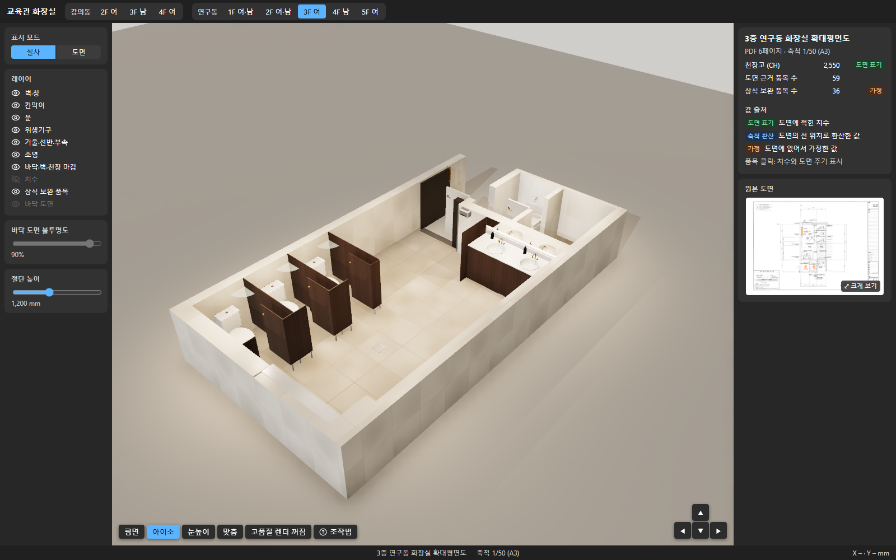
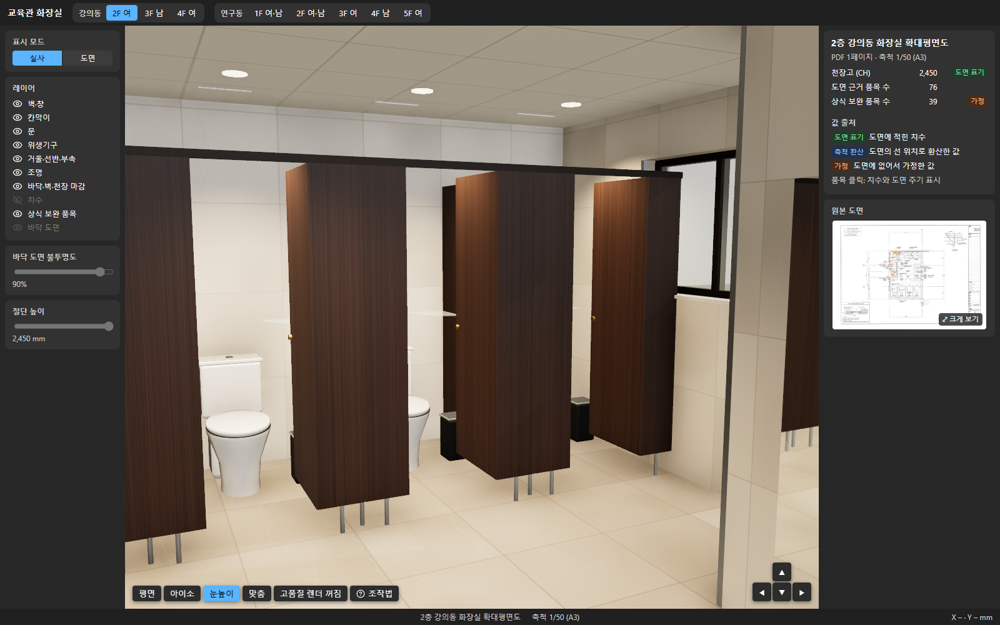
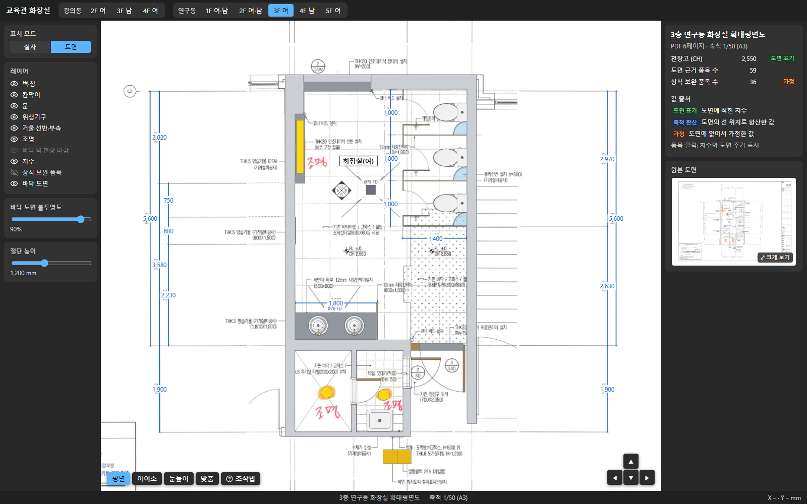

# A 3D Restroom Viewer Built from Floor-Plan PDFs

[한국어](README.md) | **English**

This project turns 8 scanned restroom floor-plan pages into 8 browsable 3D restrooms. It was built in two days in conversation with an AI assistant (Claude Code). The code, the documents, the decisions made along the way and the verification records are all public.

> The goal of this repository is to show how someone who is not a developer can start from nothing but a floor plan and end up with a result like this.

- **Live demo**: <https://bohe76.github.io/toilet-plan-3d-viewer/>
- **How it was made (plain-language story, Korean)**: [docs/guides/project_story_for_friends.md](docs/guides/project_story_for_friends.md)

| Photoreal mode (isometric) | Photoreal mode (eye level) |
|---|---|
|  |  |

| Plan mode: the 3D model overlaid on the scanned drawing to check that they match |
|---|
|  |

> The viewer interface and most documents are in Korean. The scanned drawings are Korean as well.

## What it does

- Pick one of 8 restrooms from the tabs at the top (lecture building floors 2–4, research building floors 1–5).
- Walls, stalls, doors, toilets and sinks are modeled directly from the dimensions on the drawing. The original scan is laid underneath as the floor. If the model is wrong, it visibly drifts from the drawing.
- Two display modes:
  - **Plan mode**: the model overlaid on the scanned drawing.
  - **Photoreal mode**: tiles, ceramics, mirrors and shadows for a photo-like look. A "high-quality render" switch traces light bounces for an even more realistic still image. It is slow.
- Three viewpoints: top, isometric and eye level (as if you walked in).
- Click any item to see its name, size and the drawing's own note. The panel also tells you whether a value was written on the drawing, converted from the drawing's lines, or assumed by the AI as common sense.

## How it started

The first request was one sentence: "I have a floor-plan PDF. I want to see it as 8 tabs in 3D. Propose how to build it." The steps were:

1. **Ask for proposals first.** The PDF is a scan, so neither lines nor text can be extracted. Three ways to build the 3D view were compared. The chosen one models the plan from its dimensions and lays the original drawing underneath, so mistakes show up immediately.
2. **Build one sheet first.** The smallest drawing (research building, floor 3) became the pilot.
3. **Have a different AI check the work.** Every tab was checked against the original drawing by an independent AI agent. The agent that built the model never shared its conclusions with the checker. This rule was set on day one and kept to the end.
4. **Split the remaining seven.** Shared parts were extracted first, one representative tab per drawing family was finished next, and the rest were built in parallel.
5. **Refine by looking at the screen.** The person described what they wanted, the AI first explained what it understood, and implementation started only after the person said "start".

The full chronological story (the person's instructions and feedback, the AI's actions, the AI's mistakes and how they were corrected) is in the [story document](docs/guides/project_story_for_friends.md) (Korean).

## Trying it with your own floor plan

This repository is a **worked example** of a method. It is not a one-click converter. Reading dimensions off a scan and turning them into data is done by an AI and a person working together.

1. Prepare your own floor-plan PDF. (The original PDF is not included here.)
2. Clone this repository and follow [docs/guides/measurement_workflow.md](docs/guides/measurement_workflow.md): straighten the scan, make ruler tiles, read dimensions, write model data, run an independent check.
3. The briefs [docs/guides/tab_author_brief.md](docs/guides/tab_author_brief.md) and [tab_verifier_brief.md](docs/guides/tab_verifier_brief.md) can be handed to an AI agent as instructions. They are written in Korean; ask your AI assistant to adapt them to your language.

To convert a PDF into images and correct the scan skew (Python 3 required):

```bash
python -m venv .venv
.venv/bin/python -m pip install -r scripts/requirements.txt
.venv/bin/python scripts/prep_plans.py "my_plan.pdf" public/plans work/plans_300
```

On Windows use `.venv\Scripts\python.exe` instead.

## Run it

Node.js and [pnpm](https://pnpm.io) are required.

```bash
pnpm install
pnpm dev
```

Checks: `pnpm typecheck` and `pnpm lint`. Production files: `pnpm build`.

The initial state can be set with URL parameters, for example `?sheet=research-3f&view=top&cut=1200`.

| Parameter | Meaning |
|---|---|
| `sheet` | Tab id (e.g. `research-3f`, `lecture-2f`) |
| `view` | `top`, `iso` or `eye` |
| `cut` | Wall cut height in mm |
| `dim=1` | Show the dimension layer |
| `mode=plan` | Start in plan mode (default is photoreal) |
| `added=0` / `added=1` | Hide / show the common-sense items that are not on the drawing |
| `hq=1` | Start with the high-quality render switch on |

## Folder layout

| Folder | Contents |
|---|---|
| `src/data/` | The 3D model data for each tab: drawing-based items (`<tab>.ts`) and assumed items (`<tab>_added.ts`) |
| `src/scene/`, `src/ui/`, `src/App.tsx` | The viewer (3D scene, panels, controls) |
| `public/plans/` | The 8 skew-corrected scan images |
| `scripts/` | Python scripts that rasterize the PDF and detect lines |
| `tools/` | Helper tools: screenshots, model diffs, overlap checks |
| `docs/` | All documentation (Korean). Index: [docs/index.md](docs/index.md) |

The verification records (`docs/verification/`) and the drawing-reading notes (`docs/drawings/`) are included. The screenshots used during verification and the chat logs are not.

## Known limitations

- The high-quality render is very slow on integrated graphics.
- Doors are shown only in the open state drawn on the plan. They cannot be opened or closed.
- There are no touch controls for phones or tablets.
- In eye-level view you can walk through walls.
- Some values are not on the drawing and were assumed by the AI. They are marked "assumed" in the info panel.

## License

Source code and documents are under the [MIT License](LICENSE).

**The drawings are an exception.** The scanned drawing images in `public/plans/` and the drawing-reading notes in `docs/drawings/` are derived from the original drawings and are not covered by the MIT License. The rights to the original drawings belong to their owner. Before publishing, the party that provided the drawings confirmed that there is no security concern. The original PDF is not in this repository. See [NOTICE.md](NOTICE.md).

## How it was built

A person set the direction and checked the screen. The AI (Claude Code) wrote the code. Every tab was checked against the original drawing by a different AI from the one that built it. No high-severity mismatch remained. Because the models were made by reading a scan by eye, errors of a few millimeters may remain. They are recorded in the verification notes.
