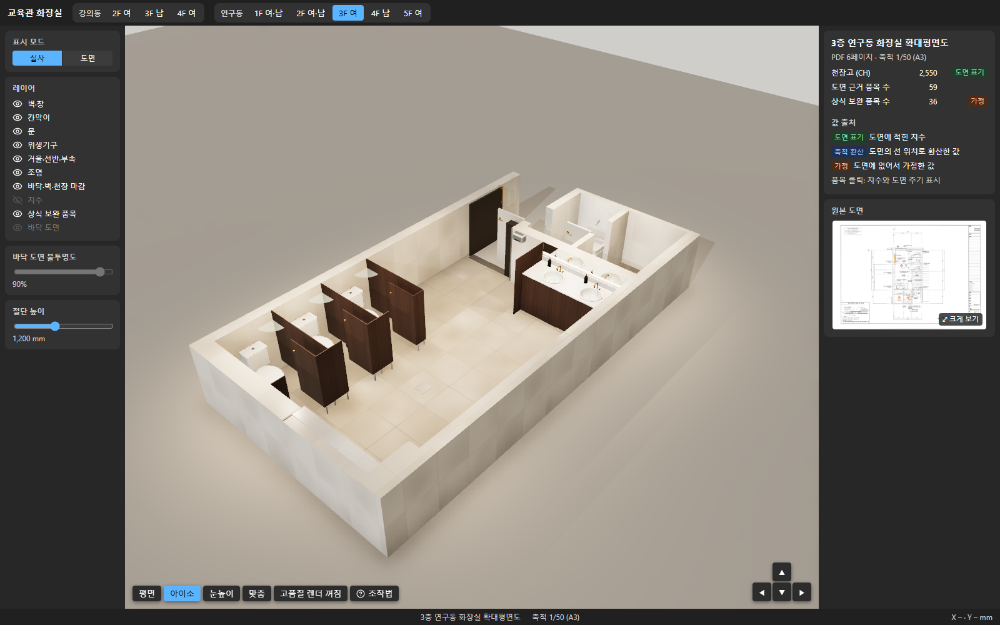
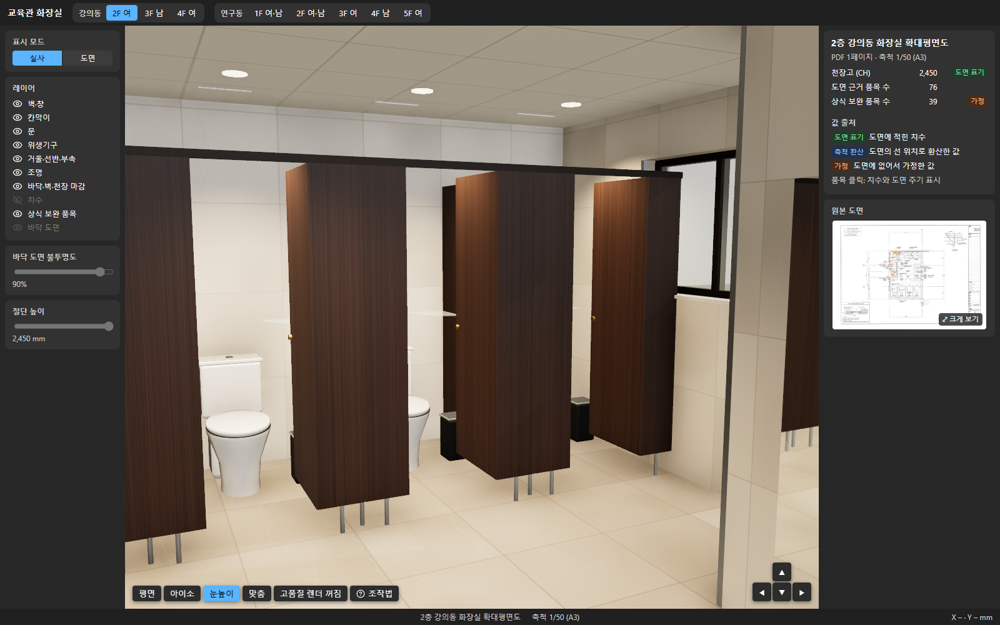
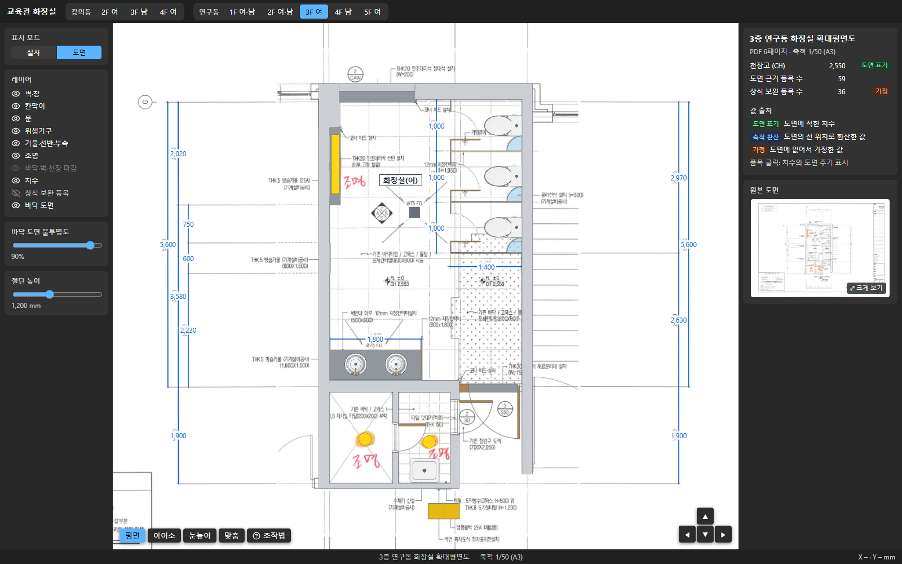

# 평면도 PDF로 만드는 3D 화장실 뷰어

**한국어** | [English](README.en.md)

스캔한 화장실 평면도 PDF 8장을 브라우저에서 돌려 보는 3D 화장실 8곳으로 바꾼 프로젝트다. AI(Claude Code)와 대화하면서 이틀 만에 만들었다. 코드, 문서, 대화에서 내린 결정과 검수 기록까지 모두 공개한다.

> 평면도 한 장만 있을 때, 개발을 몰라도 이런 결과물을 어떻게 시작하고 만드는지 보여 주는 것이 이 저장소의 목적이다.

- **완성 화면 보기**: <https://bohe76.github.io/toilet-plan-3d-viewer/>
- **어떻게 만들었는지 읽기(비개발자용 이야기)**: [docs/guides/project_story_for_friends.md](docs/guides/project_story_for_friends.md)

| 실사 모드 (아이소) | 실사 모드 (눈높이) |
|---|---|
|  |  |

| 도면 모드: 스캔 도면 위에 3D 모형을 겹쳐 맞는지 확인 |
|---|
|  |

## 무엇을 하는 프로젝트인가

- 화장실 8곳(강의동 2·3·4층, 연구동 1·2·3·4·5층)의 평면도를 위쪽 탭으로 골라 본다.
- 도면의 치수를 읽어 벽, 칸막이, 문, 변기, 세면대를 직접 3D 모형으로 만들었다. 그 아래에 원본 스캔 도면을 깔아 두었다. 모형이 틀리면 바닥 도면과 어긋나서 눈으로 바로 보인다.
- 화면은 두 가지다.
  - **도면 모드**: 스캔 도면 위에 모형을 겹쳐 본다.
  - **실사 모드**: 타일, 도기, 거울, 그림자를 넣어 사진처럼 본다. 「고품질 렌더」 스위치를 켜면 빛의 반사까지 계산해서 더 사실적으로 다듬는다. 오래 걸린다.
- 시점은 평면, 아이소, 눈높이 3가지다. 눈높이 시점은 걸어 들어간 사람의 눈으로 본다.
- 품목을 누르면 이름, 크기, 도면 주기가 나온다. 그 값이 도면에 적힌 값인지, 도면 선에서 환산한 값인지, AI가 상식으로 가정한 값인지 구분해서 표시한다.

## 어떻게 시작했나

처음에는 "평면도 PDF가 있는데 3D 탭 8개로 보고 싶다. 어떤 방식으로 만들지 제안하라"는 한 문장이었다. 아래 순서로 진행했다.

1. **제안부터 받았다.** 도면이 글자도 선도 읽을 수 없는 스캔본이라서 3D로 만드는 방법을 3가지로 비교했다. 치수로 모형을 만들고 그 아래에 원본 도면을 까는 방식을 골랐다. 틀리면 눈에 바로 보이기 때문이다.
2. **한 장만 먼저 만들었다.** 가장 작은 도면 1장(연구동 3층)을 시험작으로 완성하고 확인했다.
3. **만든 쪽이 아닌 다른 AI가 검수했다.** 모든 탭을 원본 도면과 대조하는 독립 검수를 거쳤다. 만든 AI의 결론은 검수자에게 알려 주지 않았다. 이 규칙은 첫날 정했고 끝까지 지켰다.
4. **나머지 7장은 나눠서 만들었다.** 공용 부품을 먼저 뽑고, 도면 종류별 대표 탭을 먼저 끝낸 뒤 나머지를 동시에 진행했다.
5. **화면을 보며 다듬었다.** 사람이 화면을 보고 요구를 말하면, AI가 먼저 이해한 내용을 설명하고, 사람이 "시작"이라고 하면 구현했다.

전체 과정은 [비개발자용 이야기](docs/guides/project_story_for_friends.md)에 시간순으로 있다. 사람의 지시, 피드백, AI의 행동, AI가 틀린 일과 바로잡은 방법을 담았다.

## 내 평면도로 해 보려면

이 저장소는 평면도 PDF를 3D로 바꾸는 **방법의 사례**다. 도구 하나로 PDF를 자동 변환하지는 않는다. 스캔본에서 치수를 읽고 데이터로 옮기는 일은 AI와 사람이 함께 한다.

1. 자신의 평면도 PDF를 준비한다. (이 저장소에는 원본 PDF가 없다.)
2. 이 저장소를 내려받고 [docs/guides/measurement_workflow.md](docs/guides/measurement_workflow.md)의 절차를 따른다. 스캔 기울기 보정, 눈금 이미지 만들기, 치수 읽기, 모형 데이터 작성, 독립 검수 순서다.
3. AI에게 일을 맡길 때는 [docs/guides/tab_author_brief.md](docs/guides/tab_author_brief.md)와 [tab_verifier_brief.md](docs/guides/tab_verifier_brief.md)를 그대로 지침서로 쓸 수 있다.
4. 첫 요청 예시는 비개발자용 이야기의 「첫 요청 예시」에 있다.

PDF를 이미지로 바꾸고 기울기를 보정하는 명령은 아래와 같다. (Python 3 필요)

```powershell
python -m venv .venv
.venv\Scripts\python.exe -m pip install -r scripts\requirements.txt
.venv\Scripts\python.exe scripts\prep_plans.py "내도면.pdf" public\plans work\plans_300
```

macOS와 Linux에서는 `.venv/bin/python` 으로 바꿔 쓴다.

## 실행

Node.js와 [pnpm](https://pnpm.io)이 필요하다.

```powershell
pnpm install
pnpm dev
```

검사 명령은 `pnpm typecheck` 와 `pnpm lint` 다. 배포용 파일은 `pnpm build` 로 만든다.

URL 인자로 처음 상태를 정할 수 있다. 예: `?sheet=research-3f&view=top&cut=1200`

| 인자 | 뜻 |
|---|---|
| `sheet` | 탭 번호(예: `research-3f`, `lecture-2f`) |
| `view` | `top`(평면), `iso`(아이소), `eye`(눈높이) |
| `cut` | 벽을 자르는 높이(mm) |
| `dim=1` | 치수 레이어를 켠다 |
| `mode=plan` | 도면 모드로 시작한다(기본은 실사 모드) |
| `added=0` / `added=1` | 도면에 없는 상식 보완 품목을 끈다 / 켠다 |
| `hq=1` | 고품질 렌더 스위치를 켠 채로 시작한다 |

## 폴더 구조

| 폴더 | 내용 |
|---|---|
| `src/data/` | 탭마다의 3D 모형 데이터. 도면 근거 품목(`<탭>.ts`)과 상식 보완 품목(`<탭>_added.ts`)을 나눈다 |
| `src/scene/`, `src/ui/`, `src/App.tsx` | 화면(3D 장면, 패널, 조작) |
| `public/plans/` | 기울기를 보정한 스캔 도면 이미지 8장 |
| `scripts/` | PDF를 이미지로 바꾸고 선을 검출하는 Python 스크립트 |
| `tools/` | 화면 캡처, 모형 비교, 겹침 검사 같은 점검 도구 |
| `docs/` | 문서 전체. 목록은 [docs/index.md](docs/index.md) |

문서는 한국어다. 검수 기록(`docs/verification/`)과 도면 판독 기록(`docs/drawings/`)도 들어 있다. 검수 때 쓴 캡처 이미지와 대화 기록은 저장소에 없다.

## 알려진 한계

- 고품질 렌더는 내장 그래픽에서 매우 느리다.
- 문은 도면에 그려진 열린 상태로만 보인다. 여닫는 기능이 없다.
- 터치 화면(휴대폰, 태블릿) 조작이 없다.
- 눈높이 시점에서 벽을 통과할 수 있다.
- 일부 값은 도면에 없어서 AI가 상식으로 가정했다. 정보 패널의 「가정」 표시로 구분한다.

자세한 목록은 [docs/handover/session_handover.md](docs/handover/session_handover.md)의 5절에 있다.

## 라이선스

소스 코드와 문서는 [MIT 라이선스](LICENSE)다.

**도면은 예외다.** `public/plans/` 의 스캔 도면 이미지와 `docs/drawings/` 의 도면 판독 기록은 원본 도면에서 나온 자료다. MIT 라이선스에 포함되지 않는다. 원본 도면의 권리는 도면의 소유자에게 있다. 공개 전에 도면을 받은 쪽으로부터 보안상 문제가 없다는 확인을 받았다. 원본 PDF는 이 저장소에 없다. 자세한 내용은 [NOTICE.md](NOTICE.md)에 있다.

## 만든 방법

사람이 방향을 정하고 화면을 확인했다. 코드는 AI(Claude Code)가 작성했다. 모든 탭은 만든 AI와 다른 AI가 원본 도면과 대조해 검수했다. 검수에서 심각한 불일치(높음 등급)는 한 건도 남지 않았다. 다만 스캔본을 눈으로 읽어 옮긴 모형이므로 mm 단위의 오차가 남아 있을 수 있다. 오차는 검수 기록에 남아 있다.
